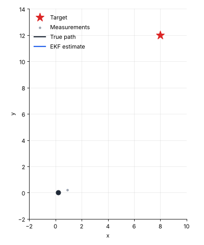
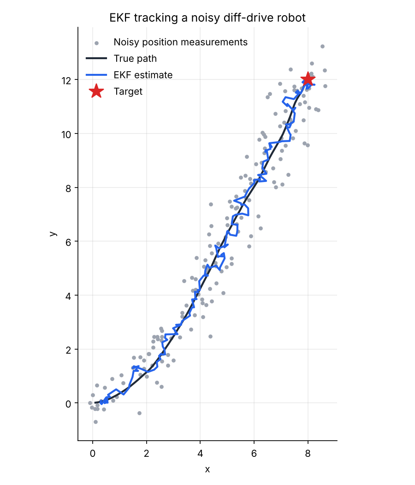

# Autonomous Mobile Robot — State Estimation and SLAM

A robotics estimation project progressing from a Python simulation to localization and mapping on recorded robot data. The goal is to implement an Extended Kalman Filter (EKF) and EKF-SLAM, evaluate them against motion-capture ground truth, and explain the modeling and implementation decisions behind the results.

**Current stage:** Python simulation with noisy motion, position measurements, PD go-to-goal control, and EKF pose estimation. The real-data pipeline is planned and has not been implemented yet.

**Next milestone:** Load one robot from UTIAS MRCLAM Dataset 1, integrate its logged odometry, and measure dead-reckoning drift against ground truth.

## Current implementation

The simulation models a differential-drive robot using unicycle kinematics with state `[x, y, θ]` and velocity inputs `(v, ω)`.

- **Motion and sensing:** Independent Gaussian noise is added to linear and angular velocity. A simulated sensor measures position `(x, y)` with additional Gaussian noise.
- **Control:** Separate PD controllers regulate distance and heading error. The controller class supports an integral term, but its gain is zero in the current experiments. Commands are limited, and forward speed is reduced when the robot faces away from the goal.
- **Estimation:** Raw position measurements, exponential smoothing, and an EKF are exercised in separate simulation runs. The EKF predicts pose from velocity commands and corrects it using position measurements; heading is not directly measured by the sensor.
- **Outputs:** A script runs 100 trials per method and prints RMS statistics. A second script generates the trajectory plot and animation below.

### Simulation settings

The simulation uses metres, seconds, and radians as its unit convention.

| Parameter | Value |
|---|---|
| Initial pose | `(0 m, 0 m, 0 rad)` |
| Goal position | `(8 m, 12 m)` |
| Time step | `0.1 s` |
| Linear velocity noise standard deviation | `0.1 m/s` |
| Angular velocity noise standard deviation | `0.1 rad/s` |
| Position measurement noise standard deviation | `0.5 m` per axis |
| Command limits | `v ∈ [0, 1] m/s`, `ω ∈ [-1, 1] rad/s` |

### Simulation preview





These figures illustrate the existing simulation, not performance on real robot data.

### Evaluation status

Quantitative results are pending a correction to the simulation logging: estimates and measurements are currently recorded before each motion step, while the corresponding ground-truth positions are recorded after it. The RMS comparison therefore uses different time instants. Results will be regenerated after those samples are aligned.

The current experiments also use separate trajectories for each method. The raw-measurement and smoothing controllers receive the true heading, while the EKF controller uses estimated heading. This setup does not isolate estimator accuracy on a shared sequence of observations.

## Run the simulation

From the repository root, with Python 3 installed:

```bash
cd sim
python3 -m venv venv
source venv/bin/activate
python -m pip install -r requirements.txt

python diff_drive_sim.py
python make_figures.py
```

The activation command above is for macOS/Linux. `diff_drive_sim.py` prints the provisional RMS statistics described above. `make_figures.py` writes `docs/ekf_path.png` and `docs/ekf_run.gif`.

## Planned real-data pipeline

The next stage uses the [UTIAS Multi-Robot Cooperative Localization and Mapping (MRCLAM) dataset](https://asrl.utias.utoronto.ca/datasets/mrclam/index.html), which provides logged velocity commands, range-bearing observations, barcode associations, and motion-capture ground truth. Initial work will use one robot and observations of static landmarks; robot-to-robot observations will be excluded.

| Stage | Planned work | Evidence of completion |
|---|---|---|
| 1. Data loading and dead reckoning | Inspect file formats, units, and timestamps; load one robot from Dataset 1; integrate odometry and align estimates with ground truth for evaluation. | Trajectory and drift plots, plus baseline position RMS error. |
| 2. EKF localization with a known map | Implement landmark range-bearing updates and their Jacobian; handle multiple or missing observations; use data to inform process and measurement noise assumptions. | EKF vs. dead-reckoning error on at least three datasets, plus a check of whether reported uncertainty matches observed errors. |
| 3. EKF-SLAM | Estimate landmark positions alongside robot pose, initialize landmarks when first observed, and evaluate both trajectory and map. | Map-building animation and localization vs. SLAM error comparison. |
| 4. Later extensions | Rebuild the estimator in C++/Eigen once the Python implementation is understood and validated, then add ROS 2 dataset replay and pose publishing. | Python/C++ agreement tests and an RViz demonstration. |

The first major target is evaluated EKF localization on real data. SLAM, C++, and ROS 2 are subsequent extensions.

## Repository layout

```text
sim/
  diff_drive_sim.py   # Robot model, control, estimators, and simulation trials
  make_figures.py     # Generates the simulation plot and animation
  requirements.txt   # Python dependencies
docs/
  ekf_path.png
  ekf_run.gif
```

Real-data loaders, SLAM, and automated validation tests will be added as those stages are implemented.
